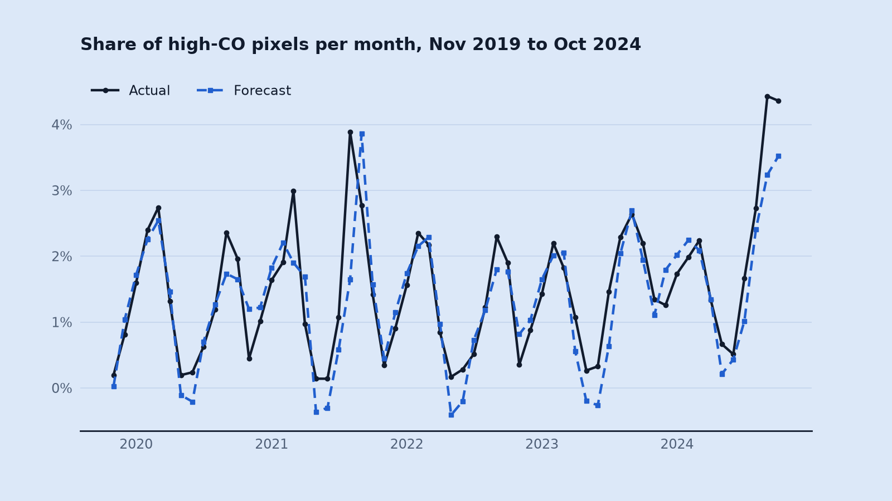
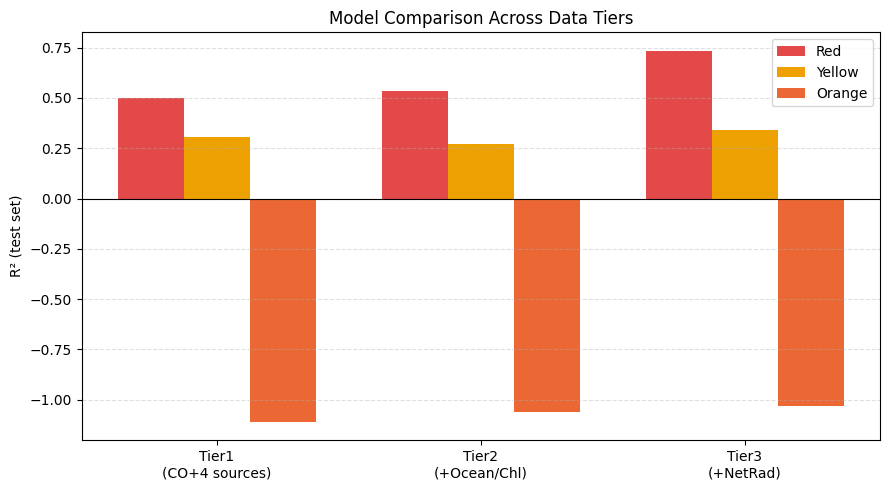
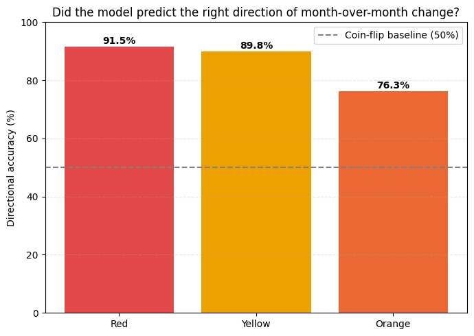
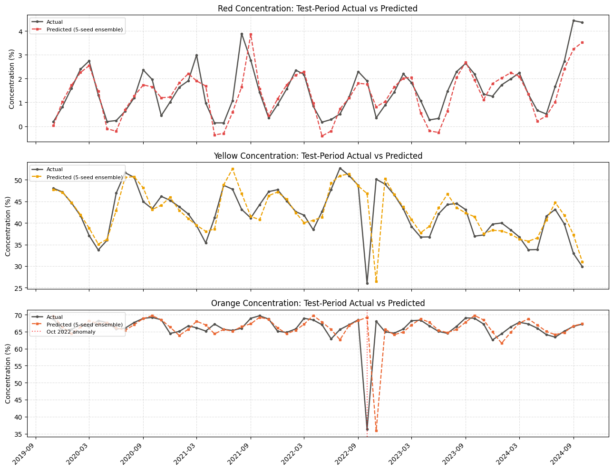
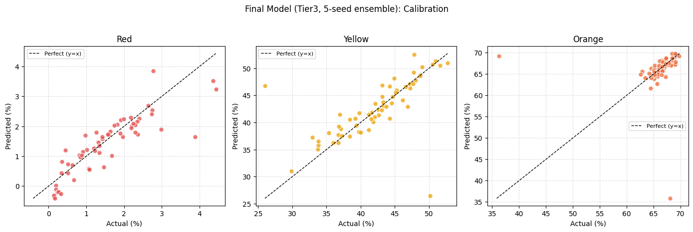
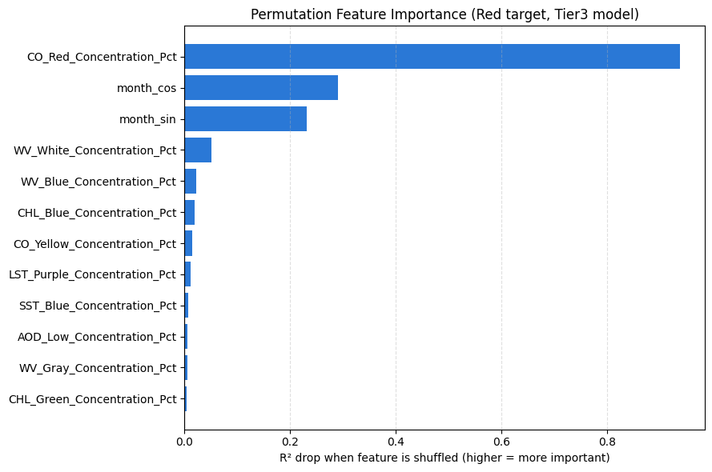
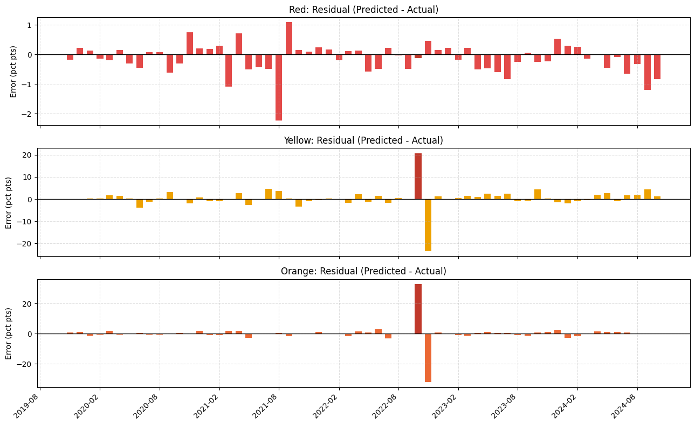

# Carbon Monoxide Forecasting

Forecasting next month's share of high-carbon-monoxide coverage from ten NASA satellite datasets with a small Conv1D + GRU network.

NASA publishes a monthly global carbon monoxide (CO) map, but only as a picture. This project turns 24 years of those maps into a time series: each map is thresholded in HSV colour space into CO bands, giving the share of pixels in each band per month. Nine other NASA satellite layers are merged in month by month, and a Conv1D + GRU network forecasts next month's high-CO (Red) coverage.

A course project for CS190-4P Computer Vision and Image Processing, a third-year course, by a team of three.

## Results

Test set: the last 60 months, November 2019 to October 2024, held out in time order. The final forecast averages five models trained from different random seeds (Tier 3 data).

| Band | R² | Directional accuracy | MAE (percentage points) |
| --- | --- | --- | --- |
| Red (high CO) | **0.730** | **91.5%** | 0.385 |
| Yellow | 0.356 | 89.8% | 2.119 |
| Orange | −1.057 | 76.3% | 2.003 |

- **Red R² 0.730**, against 0.476 for repeating the same month last year and 0.197 for repeating last month.
- **91.5%** of months had the direction of change right for Red.
- **±0.032** spread in Red R² across the five individually trained runs (mean 0.706), so the result isn't one lucky start.
- **Walk-forward check** across three expanding folds: Red held between 0.55 and 0.67 and Yellow between 0.44 and 0.85, with the weakest fold nearest the October 2022 anomaly.
- **Feature importance** (shuffling one input at a time): CO's own history dropped R² by 0.938 and the month encoding by 0.29 and 0.23. The best satellite layer, water vapor, dropped it by 0.051.

| | |
| --- | --- |
|  |  |
|  |  |
|  |  |

## Method

1. **From maps to numbers.** 296 monthly maps, March 2000 to October 2024. Each is thresholded in HSV colour space into six CO bands. Only Red, Yellow and Orange carry signal; the other three average under 0.15% and were dropped. Four months where the sensor saw nothing were interpolated, not read as months with no CO.
2. **Ten sources, one table.** Aerosol optical depth and size, land and sea surface temperature, rainfall, water vapor, chlorophyll, net radiation and vegetation were merged month by month into 296 rows and 95 columns. Two layers stopped before the test years began, so they were dropped.
3. **Three data tiers.** More layers mean a shorter shared history, so three trade-offs were tested. The richest tier won on Red despite having the least data.
4. **A small model for a small dataset.** A Conv1D layer compresses the wide input, then a 20-unit GRU reads the last 12 months. It predicts how much each band moves from last month rather than the level. Weight penalties, dropout, early stopping and an outlier-tolerant loss guard against overfitting. On the same data, the Conv1D front end beat a plain GRU (Red R² 0.599 vs 0.575).
5. **No leakage.** The split is in time order and never shuffled, and scaling was fitted on training data only.

## Limits

- Orange, the most common CO band, can't be forecast here. Every method, the simple baselines included, scores a negative R² (−1.057), driven by a genuine October 2022 extreme on an almost flat series. Its typical error is still about 2 points.
- Yellow improves on the simple baselines but stays modest (R² 0.356).
- Sudden spikes are forecast a month late, and a few forecasts dip below 0%, which can't happen.
- The extra satellite layers add real but small value. The CO series' own history and the season carry most of the signal.
- A course project on 148 to 224 training windows, not an operational air-quality forecast.

## Repository contents

| Path | Contents |
| --- | --- |
| `notebooks/carbon_monoxide_forecasting.ipynb` | The final notebook, in four phases: data compilation, pre-processing, model training, and testing. Outputs are kept. |
| `data/` | The per-month colour tables for all ten sources (`*_Dataset.txt`) and the intermediate and result workbooks (`CO_*.xlsx`) the notebook reads and writes. |
| `figures/` | The result charts. |

The original NASA map images are not included.

## How to run

The notebook was written for Google Colab and reads its data from Google Drive. A GPU is not required.

1. Copy the files in `data/` into your Google Drive at `MyDrive/CS190-4P/multisource/`.
2. Open the notebook with the **Open in Colab** badge above.
3. Run the cells in order and allow the Drive mount when asked. Phases 3 and 4 can also be run on their own, because they start from the saved `CO_Phase2_Ready.xlsx`.

Retraining gives results close to, but not always exactly, the ones above, because GPU training is not fully deterministic.

To run outside Colab, install the packages in `requirements.txt`, remove the `google.colab` cells, and point `DATA_DIR` at the `data/` folder.

## Data sources

- [NASA Earth Observatory Global Maps](https://science.nasa.gov/earth/earth-observatory/global-maps): the monthly global maps for all ten layers.
- [Carbon Monoxide global map](https://science.nasa.gov/earth/earth-observatory/global-maps/carbon-monoxide), measured by the [MOPITT sensor on NASA's Terra satellite](https://terra.nasa.gov/about/terra-instruments/mopitt).

## Team

A team of three: **Indaya**, **Pernia**, and **Vinluan**.

Jherwin Indaya was the machine learning developer: built the image-to-data pipeline, merged and audited every source, and designed, trained, and evaluated the model.

## License

The code and notebook are released under the [MIT License](LICENSE). The NASA data keeps its own terms.
